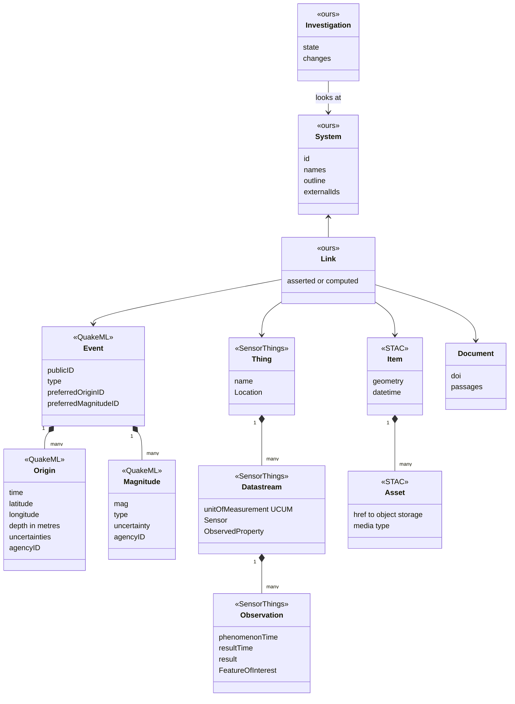
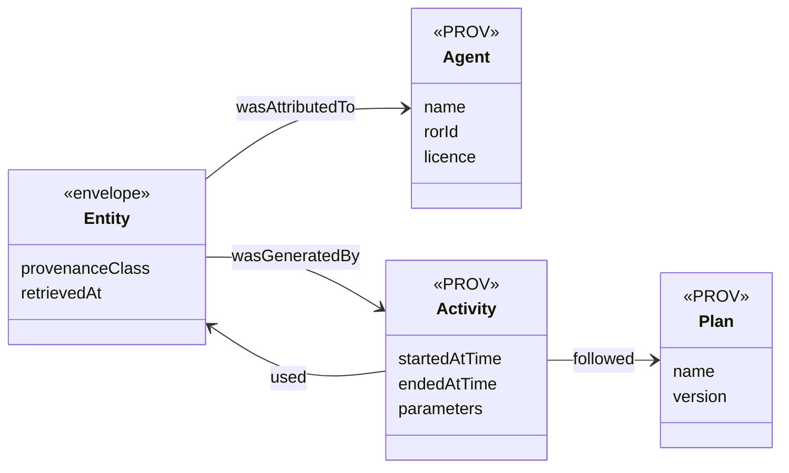

# Domain model

> DRAFT — written up from conversation as points are agreed. What the nouns ARE lives here; once the
> model settles, WHY it is this shape moves into a decision record. The standards referred to are
> verified in [`docs/research/standards.md`](../research/standards.md).

## The shape in one paragraph

Three families of scientific data, each kept in the shape its own community standardised. One thin
**envelope** that every record in every family wears, which is where provenance lives. And three
things that are Noma's alone, because no standard covers them.

**The envelope.** Every `Event`, `Origin`, `Magnitude`, `Datastream`, `Item` and `Link` is also an
`Entity`:

An `Agent` is a source such as INGV. An `Activity` is one run of a model; the `Plan` it followed is
the model and its version. An observed record has an Agent and no Activity. A modelled one has both.

| Family | Looks like on the map | Standard shape | Other tools that can then read Noma |
|---|---|---|---|
| Things that happen | a dot | QuakeML `Event` / `Origin` / `Magnitude`, served as fdsnws-event | ObsPy, SeisComP, any seismology client |
| Things measured continuously | a wiggly line | SensorThings `Thing` / `Datastream` / `Observation` | SensorThings clients, dashboards |
| Pictures and grids | an image or a field | STAC `Item` / `Asset` pointing at COG or NetCDF-CF files | QGIS, pystac, xarray |
| Places and outlines | a shape | GeoJSON over OGC API – Features | QGIS, any GIS |

## Agreed

*Numbered in the order points were settled, not by section — a point keeps its number if it moves
from Proposed to Agreed.*

**1. Where something happened is a fact; which system it belongs to is a question.** (2026-09-18)
An earthquake has a location. It does not have a volcano. "Etna's earthquakes" means *events that
fall inside Etna's outline*, asked each time — a spatial query, not a stored pointer. Storing the
pointer would turn an inference (someone chose a radius) into something that reads as a fact, and it
breaks for an earthquake between two systems.

Consequence: every System needs an outline, and where that outline sits is itself a judgement that
needs a source.

**2. An Event is not an Observation.** (2026-09-18) An Event is something that happened at a time
and place. It has identity and is the thing a user drills into. The measurements of it — where,
when, how big — are separate records, several per event, each stamped with its agency, one of each
marked preferred. This is QuakeML's shape and Noma keeps it.

Accounts accumulate for TWO reasons, and flattening to one row per event loses both:

1. **Different agencies disagree.** INGV and USGS publish their own locations and magnitudes.
2. **The same agency revises.** An automatic detection is published within seconds; a
   human-reviewed one replaces it later. The real INGV record for the M3.9 of 2026-08-15 near
   Linguaglossa is `evaluationMode: manual`, `evaluationStatus: reviewed`, `version: 100`, created
   at 10:46:43 for an event at 10:24:08 — 22 minutes of automatic-only history before it.

The second reason is the one that matters most for monitoring: overwriting means Noma can never
answer *what did we know at 10:25?*, which is the central question when an observatory reviews a
crisis afterwards. This is what `resultTime` and `retrievedAt` are for.

**19. Every version of a record received is kept.** (2026-09-23) Point 2's second reason —
agencies revise — only holds if Noma stores what it is sent each time. A record's identity in the
database is (source, public id, fingerprint of the agency's own fields): an unchanged re-fetch
conflicts and does nothing, a revision lands beside its predecessor. Reads pick the newest version
as of a moment, which is what makes *what did we know at 10:25?* a query. The fingerprint covers
the agency's fields, not Noma's envelope, because Noma fetching twice is not the agency changing
its mind — and not the agency's own version number, which would depend on every agency maintaining
it honestly.

**3. Follow the industry standards for the nouns.** (2026-09-18) Where a scientific community
already has a data model, Noma uses its vocabulary and its shape rather than inventing one.

**4. Noma is fully compliant and interoperable with other tools.** (2026-09-18) Not only a reader of
standards: other scientific tools must be able to read Noma. This replaced an earlier proposal to use
the standards' names but not build their services.

**15. A provenance class answers one question: what kind of claim is this?** (2026-09-22) Six
classes — OBSERVED, CALCULATED, MODELLED, SIMULATED, INFERRED, FORECAST. Not how Noma obtained the
record (its envelope already says), and not when it is about (its times already say). An agency's
own processing of its own instruments is OBSERVED, so INGV's earthquake locations are OBSERVED.
Noma never labels its own output FORECAST. See ADR-0005.

## Proposed, not yet agreed

**5. "Compliant" means a test passes.** A claim of compliance that nothing checks rots exactly the
way documentation does. So each interface Noma exposes is compliant *to something runnable*: the
QuakeML 1.2 XML schema, the fdsnws-event 1.2 parameter set, the OGC conformance suites for
SensorThings 1.1 and API – Features, `stac-validator`. Those run in the test suite and a decision
record names them in `pinned-by`.

Note the limit the research found: the general observation standard (ISO 19156:2023) is abstract —
there is no service to be compliant *with*, and no approved JSON. The testable target for
measurements is SensorThings 1.1.

**6. One envelope, several shapes — never one giant observation table.** Each family keeps its
community's shape. What they share is thin: provenance class, source, licence, the two times. This
is the answer to "is an observation one shape or many": many, by design.

**7. The provenance class sits on top of the standards, is required, and travels in their extension
slots.** The observation standard says "there is no conceptual distinction between observations,
interpretations and simulations". Noma is deliberately stricter. Internally the class is required
on every record. On the way out it rides in the places the standards provide for extra information
(SensorThings `properties`, STAC item properties, QuakeML `creationInfo` and comments) — so the
output stays valid AND keeps the distinction. A Datastream is observed or modelled, never mixed.

**8. Keep what we were given, exactly.** To serve QuakeML we must not have lost any of it. The
original document goes to object storage untouched; the database indexes the parts Noma queries
(Event, Origin, Magnitude). Same for every family. This is also CLAUDE.md's "do not silently
discard scientific metadata", made mechanical.

**9. Internal units and signs follow the standard we must re-serve.** Depth is metres, positive
downward, negative allowed (QuakeML). Kilometres appear only at the edges that ask for them (the
fdsnws text format). Coordinates are longitude, latitude internally (GeoJSON, CRS84).

**10. An agency's event stays that agency's event.** Noma does not merge INGV's and USGS's record of
one earthquake into a record of its own. "These two are the same earthquake" is a computed Link,
labelled INFERRED. Which agency the map draws by default for a given System is a Noma choice that
names its reason.

**11. A stored link between two things says where it came from.** "This eruption is Etna's" is
asserted by a catalogue. "These two agencies' records are the same earthquake" is computed. Both are
Links and both wear the envelope.

"This earthquake is inside Etna's outline" is NOT a Link — per point 1 it is a spatial query asked
each time and never stored. A Link is for a connection someone asserted, or one too expensive to
work out on every look.

**12. A System has its own identity; catalogue numbers hang off it.** Sakurajima has no entry in the
Smithsonian catalogue — it is filed under Aira (282080).

**13. A Source carries its licence.** INGV's data is CC BY 4.0, so attribution is a legal
requirement; re-serving it makes that Noma's obligation too. One volcanology database forbids
redistribution outright and cannot be ingested.

**14. Designed in from the first table; exposed one interface at a time.** Designing for compliance
is nearly free — it is naming and structure. Building every service at once is not. Each interface
goes live when its family does: fdsnws-event with the first earthquakes, the others as their data
arrives.

**16. Contributed data is data, held to the same rules.** (2026-09-22, proposed — LATER, NOT NOW.
Everything is public agency data until accounts exist, so there is nothing to keep apart. What is
required now is only that nothing forecloses it.) A researcher's own
measurements and their own model runs are ordinary records: same envelope, same provenance class,
same required units and uncertainty. What differs is only the Source — a person rather than an
agency — and that Noma did not fetch it.

Two things follow, neither of them urgent — an earlier draft of this point called them "cheap now
and expensive later", which was a general rule quoted without checking it against where Noma
actually is. With no queries written and no private data in existence, adding a nullable owner
column and backfilling it to "public" is a small migration, and there is nothing to leak in the
meantime:

- **Owner and visibility on every record**, and every query behind a public interface filters on
  visibility.
- **A Source may be a person.** ORCID identifies researchers as ROR identifies organisations. The
  licence on a Source already governs re-serving (point 13); for contributed data the uploader sets
  it, so "may Noma re-serve this?" becomes a question with a per-record answer.

**17. Ingestion of contributed data is a conversation, and the conversation IS the provenance.**
(2026-09-22, proposed — LATER, NOT NOW.) Agencies send QuakeML, StationXML, NetCDF — formats that carry units,
timestamps with timezones, uncertainties and a stated method. A researcher sends a spreadsheet,
which carries none of those. Every rule Noma enforces at the QuakeML boundary has no source of
truth at the spreadsheet boundary.

So an upload cannot be a file picker. Noma has to ask — what is this column, in what units, in
which timezone, measured how, how uncertain, who measured it, who may see it — and the answers ARE
the record's provenance. This is the same shape as the product principle: look, ask, understand.

**18. Contributed records belong to a named Dataset.** (2026-09-22, proposed — LATER, NOT NOW. A
dataset can be reconstructed from what records already carry: their source and the document they
arrived in.) A researcher's upload
is not loose records with an owner on each: it is *their SO2 campaign of March 2026*, a thing with a
name, an identity, a licence and a single provenance story. `Dataset` is the W3C Data Catalog
Vocabulary's own noun (DCAT 3, Recommendation 2024-08-22); for imagery and grids it is a STAC
`Collection`, which is the same idea in that family's language.

This is what keeps "show only mine" and "hide this campaign" possible without inventing grouping
retroactively — records that were only ever individual cannot be addressed as a set later.

It also resolves the tension with the UX principles rather than breaking them. The principle rules
out making people *navigate* data sources: a list of INGV, USGS, GVP with checkboxes. It does not
rule out a scientist asking to see their own campaign against the agency's — that is an
investigation, not navigation, and "compare mine with INGV's" is a question whose answer changes the
map. A Dataset is addressable; whether any control for it is ever persistent is a separate
question, and the answer is still no.

## Open

- "Above magnitude 2" of which magnitude type? The type is free text in the data (`ML`, `ml`, `Mw`,
  `Md`…). That the types are not comparable is standard seismology but is NOT yet sourced here.
- Build the standard services, or run existing certified ones (a SensorThings server, a Features
  server) beside our own code? A question for the architecture step, not this one.
- The Smithsonian catalogue's terms of use could not be read. Needed before System data is re-served.
