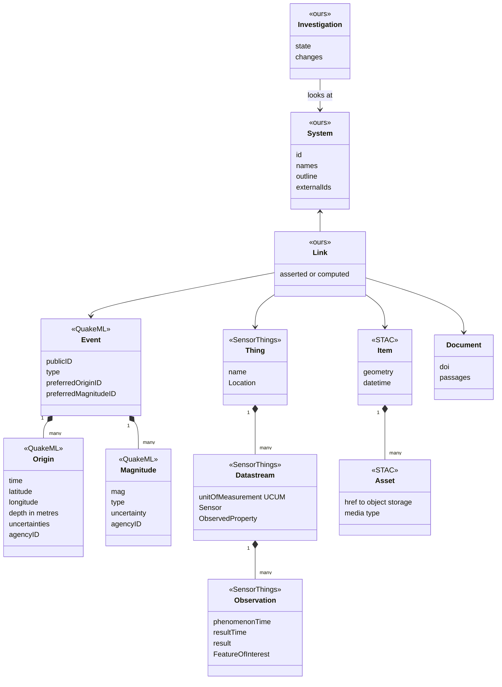
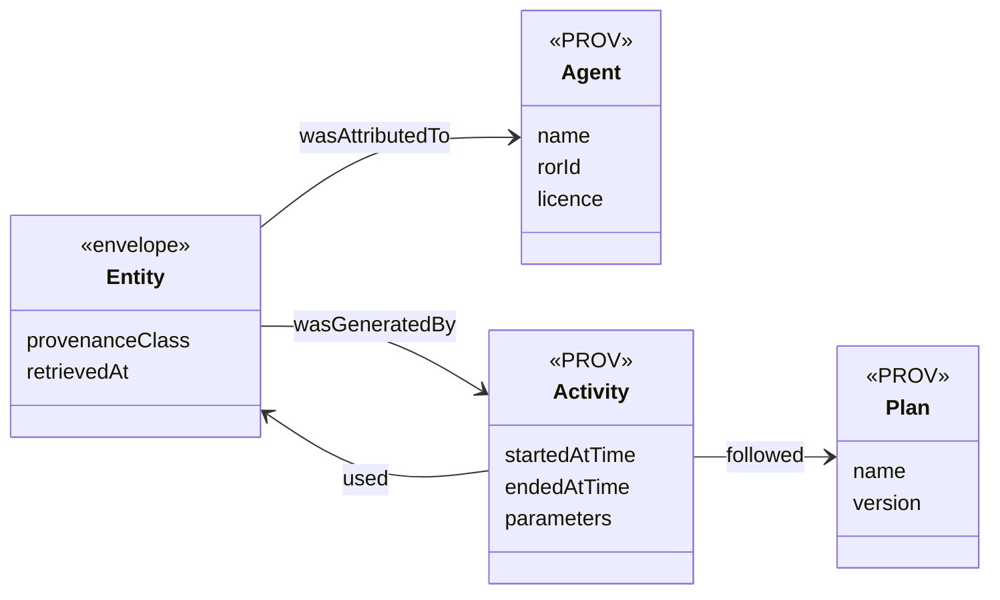

# Domain model

> DRAFT — written up from conversation as points are agreed. What the nouns ARE lives here; once the
> model settles, WHY it is this shape moves into a decision record. The standards referred to are
> verified in [`docs/research/standards.md`](../research/standards.md).

## The shape in one paragraph

Three families of scientific data, each kept in the shape its own community standardised. One thin
**envelope** that every record in every family wears, which is where provenance lives. And three
things that are Noma's alone, because no standard covers them.

**The envelope.** Every `Event`, `Origin`, `Magnitude`, `Datastream`, `Item` and `Link` is also an
`Entity`:

An `Agent` is a source such as INGV. An `Activity` is one run of a model; the `Plan` it followed is
the model and its version. An observed record has an Agent and no Activity. A modelled one has both.

| Family | Looks like on the map | Standard shape | Other tools that can then read Noma |
|---|---|---|---|
| Things that happen | a dot | QuakeML `Event` / `Origin` / `Magnitude`, served as fdsnws-event | ObsPy, SeisComP, any seismology client |
| Things measured continuously | a wiggly line | SensorThings `Thing` / `Datastream` / `Observation` | SensorThings clients, dashboards |
| Pictures and grids | an image or a field | STAC `Item` / `Asset` pointing at COG or NetCDF-CF files | QGIS, pystac, xarray |
| Places and outlines | a shape | GeoJSON over OGC API – Features | QGIS, any GIS |

## Agreed

*Numbered in the order points were settled, not by section — a point keeps its number if it moves
from Proposed to Agreed.*

**1. Where something happened is a fact; which system it belongs to is a question.** (2026-09-18)
An earthquake has a location. It does not have a volcano. "Etna's earthquakes" means *events that
fall inside Etna's outline*, asked each time — a spatial query, not a stored pointer. Storing the
pointer would turn an inference (someone chose a radius) into something that reads as a fact, and it
breaks for an earthquake between two systems.

Consequence: every System needs an outline, and where that outline sits is itself a judgement that
needs a source.

**2. An Event is not an Observation.** (2026-09-18) An Event is something that happened at a time
and place. It has identity and is the thing a user drills into. The measurements of it — where,
when, how big — are separate records, several per event, each stamped with its agency, one of each
marked preferred. This is QuakeML's shape and Noma keeps it.

Accounts accumulate for TWO reasons, and flattening to one row per event loses both:

1. **Different agencies disagree.** INGV and USGS publish their own locations and magnitudes.
2. **The same agency revises.** An automatic detection is published within seconds; a
   human-reviewed one replaces it later. The real INGV record for the M3.9 of 2026-08-15 near
   Linguaglossa is `evaluationMode: manual`, `evaluationStatus: reviewed`, `version: 100`, created
   at 10:46:43 for an event at 10:24:08 — 22 minutes of automatic-only history before it.

The second reason is the one that matters most for monitoring: overwriting means Noma can never
answer *what did we know at 10:25?*, which is the central question when an observatory reviews a
crisis afterwards. This is what `resultTime` and `retrievedAt` are for.

**3. Follow the industry standards for the nouns.** (2026-09-18) Where a scientific community
already has a data model, Noma uses its vocabulary and its shape rather than inventing one.

**4. Noma is fully compliant and interoperable with other tools.** (2026-09-18) Not only a reader of
standards: other scientific tools must be able to read Noma. This replaced an earlier proposal to use
the standards' names but not build their services.

**15. A provenance class answers one question: what kind of claim is this?** (2026-09-22) Six
classes — OBSERVED, CALCULATED, MODELLED, SIMULATED, INFERRED, FORECAST. Not how Noma obtained the
record (its envelope already says), and not when it is about (its times already say). An agency's
own processing of its own instruments is OBSERVED, so INGV's earthquake locations are OBSERVED.
Noma never labels its own output FORECAST. See ADR-0005.

**19. Every version of a record received is kept.** (2026-09-23) Point 2's second reason —
agencies revise — only holds if Noma stores what it is sent each time. A record's identity in the
database is (source, public id, fingerprint of the agency's own fields): an unchanged re-fetch
conflicts and does nothing, a revision lands beside its predecessor. Reads pick the newest version
as of a moment, which is what makes *what did we know at 10:25?* a query. The fingerprint covers
the agency's fields, not Noma's envelope, because Noma fetching twice is not the agency changing
its mind — and not the agency's own version number, which would depend on every agency maintaining
it honestly.

**20. Noma fetches because someone looked, not on a schedule.** (2026-09-23) Looking at an area and
a window makes Noma hold that area and window; nothing runs when nobody is using Noma. Each request
to an agency is recorded — area, window, filter, when — so a pan or zoom into ground already covered
asks nothing, and "asked and the catalogue was empty" is distinguished from "never asked". A window
that ended long enough ago is settled and never re-fetched; one touching the present is rechecked.

**What this gives up, and it is not recoverable:** revisions that happen while nobody is looking.
An agency's service only ever reports what its catalogue says NOW — INGV cannot be asked what it
said at 03:00. So a detection published automatically at 03:00 and reviewed at 03:20, unwatched,
leaves only the reviewed version obtainable. For settled historical data that costs nothing; for
watching a volcano through unrest it would matter, and the answer then is a standing watch on this
same machinery rather than a different design.

**21. A source says where it answers for.** (2026-09-24) Which agency to ask about a place is data
— a region and a service URL on the source — not a constant in code. "Earthquakes here" asks every
source whose region covers the whole view; a source covering only part is left out rather than
half-answering, because a partial answer drawn on a map looks exactly like a complete one. An area
no source answers for reports that, and is never mistaken for an area with no earthquakes.

The regions are OPERATIONAL, not scientific: where Noma asks an agency, not where its instruments
reach.

This exists because the alternative failed silently. Noma asked INGV about everywhere; INGV runs
Italy's network and answers HTTP 204 for Hawaii, which Noma recorded as "asked, and the catalogue is
genuinely empty" and never asked again — a confident empty map over Kīlauea with no error.

Where two regions overlap both are asked and both answers kept (point 10). Measured for one box and
window around Etna: INGV 58 events, USGS 1 — and that one is the same earthquake, recorded by INGV
as M3.9 at 10:24:08.910 "7 km W Linguaglossa" and by USGS as M3.6 at 10:24:10.174 "1 km NE of
Sant'Alfio".

**22. Noma says who it asked, always — not only who answered.** (2026-09-24, proposed) An empty
result says nothing about the ground until you know who was consulted.

Found by flying the map to Sakurajima, one of the most active volcanoes on Earth, and reading
**"0 earthquakes"**. It was true — Noma holds none — but it reads as a claim about the volcano when
it is a fact about Noma's sources. USGS answers for the whole world and carries none of Japan's
small volcanic earthquakes (measured: zero events in the Sakurajima box over a whole year), and
Japan's own agency does not serve the FDSN standard at the addresses tried.

So the API returns the sources asked on every response, and the map distinguishes three states that
look identical and mean different things: *this many earthquakes*, *none recorded by the sources we
asked*, and *no source covers this area — nobody to ask*.

This also exposes a limit of point 21: a source's region is treated as all-or-nothing, and
completeness is not. USGS is complete worldwide only for larger events, and for small ones only over
its own networks. A region with a completeness threshold would be the honest model; saying who was
asked is the cheap half of it, and is owed regardless.

**23. Family 2 is built, and GNSS is its first source.** (2026-09-24) A Station is an instrument
somewhere; a Datastream is one instrument measuring one property, and is where the UNIT lives; an
Observation is one reading, and is where the UNCERTAINTY lives, because it differs every time.

Two fields a measurement is meaningless without, both carried on the datastream: the **procedure**
— for a processed product like a position series, the software and version are the only honest
answer to "how do you know?" — and the **reference frame**, because "moved 38 cm east" measures
nothing until you say east relative to what.

First source: INGV's RING network, 1,354 stations, CC BY 4.0 (DOI 10.13127/gnss/gipos). ESLN on
Etna's southern flank is 6,401 daily epochs from 2005 to 2026, and **every reading states its own
standard deviation** — better documented than the earthquake catalogues, where fewer than half the
depths do. Vertical is about five times less certain than horizontal, the same shape as earthquake
depth being the worst-constrained coordinate.

Observations carry the same fingerprint as events (point 19): re-ingesting the identical file wrote
0 of 19,203 readings.

**Two things must be said wherever GNSS is shown**, and neither is in the data: most of ESLN's
38 cm of eastward motion is the tectonic plate carrying Sicily rather than Etna deforming, and
Etna's summit stations are not openly published — the highest open one sits about 6 km from the
craters.

**24. A satellite detection is a pixel, and it fits none of the three families.** (2026-09-24)
NASA's FIRMS feed gives Etna its only open, live, numeric evidence of heat — the signal
volcanologists actually watch, volcanic tremor, is published as four PNG images
([volcanic activity](../research/volcanic-activity.md)). It is not an Event: nothing happened at
an instant, a radiometer looked. It is not a Datastream: no instrument sits at a place producing a
series — the *place* is different every pass. It is not a grid either. Under SensorThings it would
be an Observation whose FeatureOfInterest is its own patch of ground, and family 2 has no room for
that, because there the location belongs to the station.

So it gets its own table rather than being forced into one of the three. Whether that makes a
fourth family or an extension of the second is left open below; what is not open is that a
detection carries its own footprint.

**The centre of a pixel is not where the heat is.** `scan` and `track` — about 375 m each for this
instrument, wider towards the edge of the swath — are the ground the radiometer integrated over,
and they are required on every detection, in the model as well as in the parser. Drawn as a dot, a
measurement made over 375 m claims a precision of metres.

**The provider's confidence stays a word.** "low", "nominal", "high" is an ordinal scale; a number
in that field would invite averaging it.

**It is an active fire product, not a volcano product.** A wildfire on Etna's flank looks exactly
like a lava flow to it. Noma stores what was measured — radiated power at a place — and does not
call it volcanic. What it is evidence *of* is a question for whoever reads it.

**And it exposes an assumption in point 20.** Demand-driven fetching works because an agency keeps
its history: ask fdsnws-event for last March and last March comes back. The free FIRMS feed is a
rolling 24 hours, so looking cannot recover what was not collected. For a source with a rolling
window, "fetch because someone looked" gives history only from the day Noma started looking — the
first case where a standing watch is the only way to have the past, rather than a nicety.

**25. Freshness is two questions, and only one of them is a cadence.** (2026-10-09) A datastream
declares how often a reading is expected; Noma records when it last managed to ask. They are not
the same question and they do not have the same answer.

* **Sampled things** — a GNSS position, a satellite pass — arrive on a rhythm, so *late* means the
  next one did not turn up. The rhythm is a column on the datastream, declared rather than derived:
  readings already held give a rhythm by construction, but they cannot say that a feed which has
  **never** arrived is late. NULL is a real answer and means no stated rhythm; a stream without one
  can never be called late, which is the same discipline as an unreported uncertainty.
* **Things that happen** — earthquakes — have no rhythm. A week with no earthquakes is a quiet week.
  The only honest freshness is *when Noma last managed to ask*, which `event_fetch` already records
  for every ask including the empty ones.

The distinction is not academic: an agency answering HTTP 204 gives Noma nothing to store, so
"when did a document last arrive" stands still while Noma is asking diligently. Reading freshness
from the documents alone recreates the Kīlauea failure of point 21 with a clock attached.

**Noma never sends a verdict.** Whether a stream is late depends on when someone reads it, which
only the reader knows, so the two facts travel and the reader divides (DESIGN-0004).

Measured on the 6,401-epoch ESLN series before the cadence was declared: the median gap between
consecutive readings is **exactly 1 day** across 6,400 gaps, and **362 gaps are longer**, the
largest 135 days. A cadence is therefore an expectation and never a promise, and whatever decides
"late" has to tolerate a missed reading.

## Proposed, not yet agreed

**5. "Compliant" means a test passes.** A claim of compliance that nothing checks rots exactly the
way documentation does. So each interface Noma exposes is compliant *to something runnable*: the
QuakeML 1.2 XML schema, the fdsnws-event 1.2 parameter set, the OGC conformance suites for
SensorThings 1.1 and API – Features, `stac-validator`. Those run in the test suite and a decision
record names them in `pinned-by`.

Note the limit the research found: the general observation standard (ISO 19156:2023) is abstract —
there is no service to be compliant *with*, and no approved JSON. The testable target for
measurements is SensorThings 1.1.

**6. One envelope, several shapes — never one giant observation table.** Each family keeps its
community's shape. What they share is thin: provenance class, source, licence, the two times. This
is the answer to "is an observation one shape or many": many, by design.

**7. The provenance class sits on top of the standards, is required, and travels in their extension
slots.** The observation standard says "there is no conceptual distinction between observations,
interpretations and simulations". Noma is deliberately stricter. Internally the class is required
on every record. On the way out it rides in the places the standards provide for extra information
(SensorThings `properties`, STAC item properties, QuakeML `creationInfo` and comments) — so the
output stays valid AND keeps the distinction. A Datastream is observed or modelled, never mixed.

**8. Keep what we were given, exactly.** To serve QuakeML we must not have lost any of it. The
original document goes to object storage untouched; the database indexes the parts Noma queries
(Event, Origin, Magnitude). Same for every family. This is also CLAUDE.md's "do not silently
discard scientific metadata", made mechanical.

**9. Internal units and signs follow the standard we must re-serve.** Depth is metres, positive
downward, negative allowed (QuakeML). Kilometres appear only at the edges that ask for them (the
fdsnws text format). Coordinates are longitude, latitude internally (GeoJSON, CRS84).

**10. An agency's event stays that agency's event.** Noma does not merge INGV's and USGS's record of
one earthquake into a record of its own. "These two are the same earthquake" is a computed Link,
labelled INFERRED. Which agency the map draws by default for a given System is a Noma choice that
names its reason.

**11. A stored link between two things says where it came from.** "This eruption is Etna's" is
asserted by a catalogue. "These two agencies' records are the same earthquake" is computed. Both are
Links and both wear the envelope.

"This earthquake is inside Etna's outline" is NOT a Link — per point 1 it is a spatial query asked
each time and never stored. A Link is for a connection someone asserted, or one too expensive to
work out on every look.

**12. A System has its own identity; catalogue numbers hang off it.** Sakurajima has no entry in the
Smithsonian catalogue — it is filed under Aira (282080).

**13. A Source carries its licence.** INGV's data is CC BY 4.0, so attribution is a legal
requirement; re-serving it makes that Noma's obligation too. One volcanology database forbids
redistribution outright and cannot be ingested.

**14. Designed in from the first table; exposed one interface at a time.** Designing for compliance
is nearly free — it is naming and structure. Building every service at once is not. Each interface
goes live when its family does: fdsnws-event with the first earthquakes, the others as their data
arrives.

**16. Contributed data is data, held to the same rules.** (2026-09-22, proposed — LATER, NOT NOW.
Everything is public agency data until accounts exist, so there is nothing to keep apart. What is
required now is only that nothing forecloses it.) A researcher's own
measurements and their own model runs are ordinary records: same envelope, same provenance class,
same required units and uncertainty. What differs is only the Source — a person rather than an
agency — and that Noma did not fetch it.

Two things follow, neither of them urgent — an earlier draft of this point called them "cheap now
and expensive later", which was a general rule quoted without checking it against where Noma
actually is. With no queries written and no private data in existence, adding a nullable owner
column and backfilling it to "public" is a small migration, and there is nothing to leak in the
meantime:

- **Owner and visibility on every record**, and every query behind a public interface filters on
  visibility.
- **A Source may be a person.** ORCID identifies researchers as ROR identifies organisations. The
  licence on a Source already governs re-serving (point 13); for contributed data the uploader sets
  it, so "may Noma re-serve this?" becomes a question with a per-record answer.

**17. Ingestion of contributed data is a conversation, and the conversation IS the provenance.**
(2026-09-22, proposed — LATER, NOT NOW.) Agencies send QuakeML, StationXML, NetCDF — formats that carry units,
timestamps with timezones, uncertainties and a stated method. A researcher sends a spreadsheet,
which carries none of those. Every rule Noma enforces at the QuakeML boundary has no source of
truth at the spreadsheet boundary.

So an upload cannot be a file picker. Noma has to ask — what is this column, in what units, in
which timezone, measured how, how uncertain, who measured it, who may see it — and the answers ARE
the record's provenance. This is the same shape as the product principle: look, ask, understand.

**18. Contributed records belong to a named Dataset.** (2026-09-22, proposed — LATER, NOT NOW. A
dataset can be reconstructed from what records already carry: their source and the document they
arrived in.) A researcher's upload
is not loose records with an owner on each: it is *their SO2 campaign of March 2026*, a thing with a
name, an identity, a licence and a single provenance story. `Dataset` is the W3C Data Catalog
Vocabulary's own noun (DCAT 3, Recommendation 2024-08-22); for imagery and grids it is a STAC
`Collection`, which is the same idea in that family's language.

This is what keeps "show only mine" and "hide this campaign" possible without inventing grouping
retroactively — records that were only ever individual cannot be addressed as a set later.

It also resolves the tension with the UX principles rather than breaking them. The principle rules
out making people *navigate* data sources: a list of INGV, USGS, GVP with checkboxes. It does not
rule out a scientist asking to see their own campaign against the agency's — that is an
investigation, not navigation, and "compare mine with INGV's" is a question whose answer changes the
map. A Dataset is addressable; whether any control for it is ever persistent is a separate
question, and the answer is still no.

## Open

- "Above magnitude 2" of which magnitude type? The type is free text in the data (`ML`, `ml`, `Mw`,
  `Md`…). That the types are not comparable is standard seismology but is NOT yet sourced here.
- Build the standard services, or run existing certified ones (a SensorThings server, a Features
  server) beside our own code? A question for the architecture step, not this one.
- The Smithsonian catalogue's terms of use could not be read. Needed before System data is re-served.
- Is a satellite detection (point 24) a fourth family, or family 2 with the location moved from the
  station to the reading? Answer it when a second source of the same shape arrives — a second
  satellite, or an InSAR scene — and not before, on one example.
- **What is a system's status, and where does it come from?** The interface
  ([`../design/explorer.md`](../design/explorer.md)) makes status its primary visual channel —
  marker colour, the place badge — and no open source publishes one: VONA notices and the ICAO
  colour code are PDF only, and the Smithsonian catalogue's terms block re-serving. If Noma derives
  it, Noma is the source and it is INFERRED. Nothing should be coloured by it until that is decided.
- Is a measurement read out of a publication OBSERVED with a document as its source, or does "a
  paper says so" need a class of its own? The design draws it as `retrieved`, which under ADR-0005
  describes the route rather than the kind of claim (DESIGN-0003).
